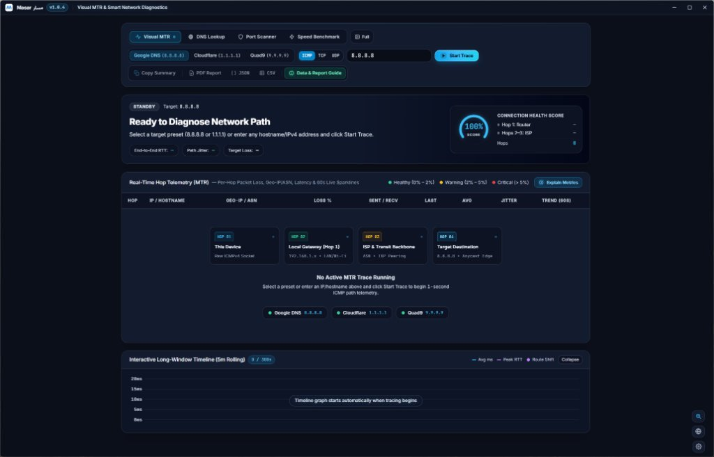
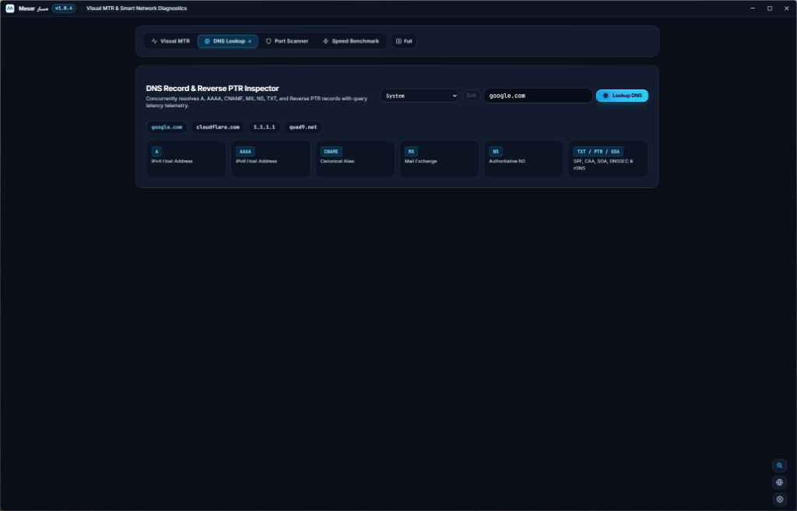
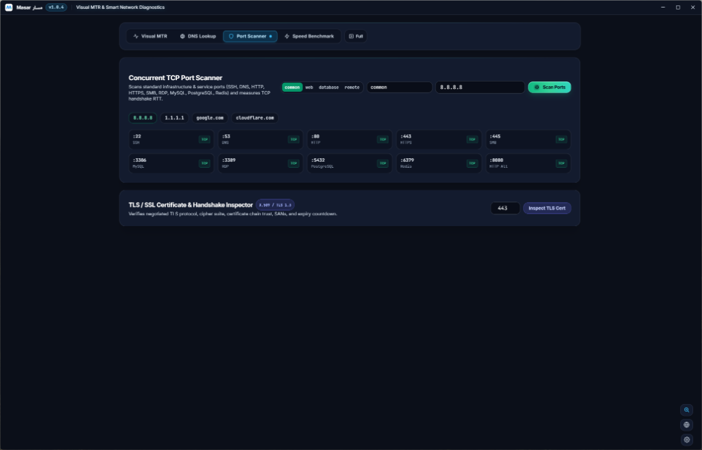
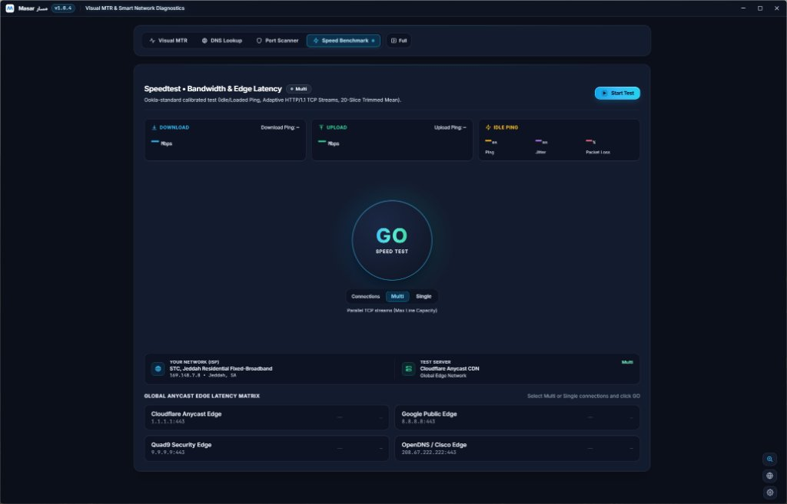
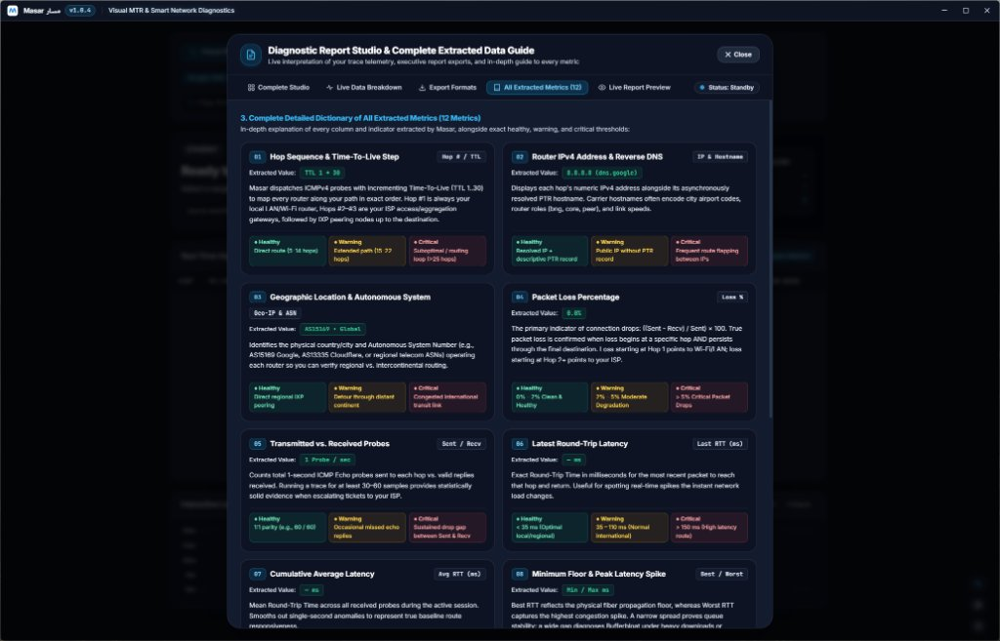
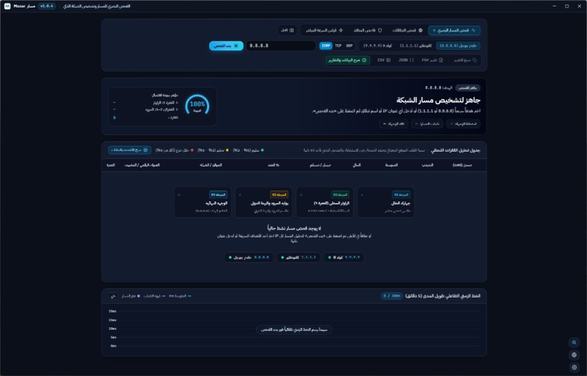
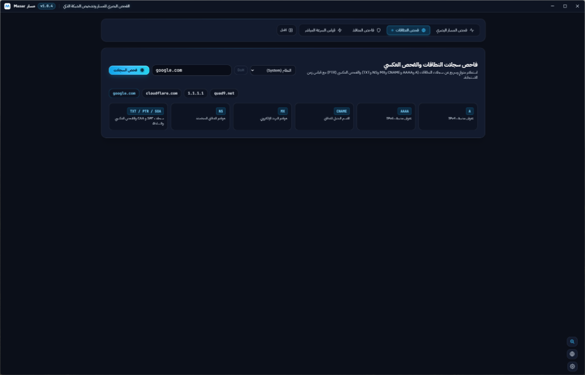
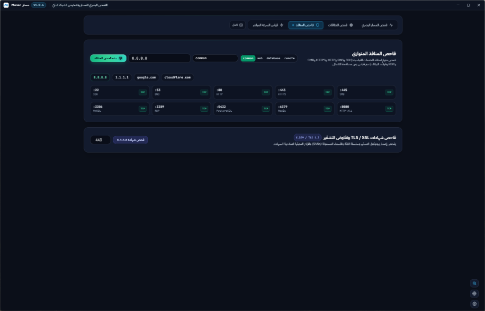
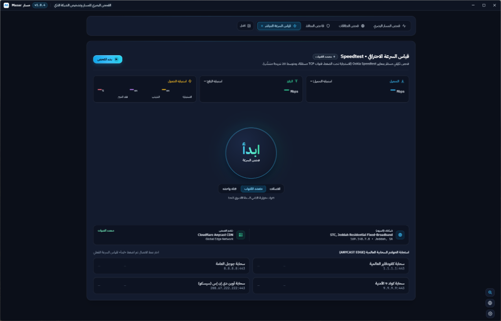
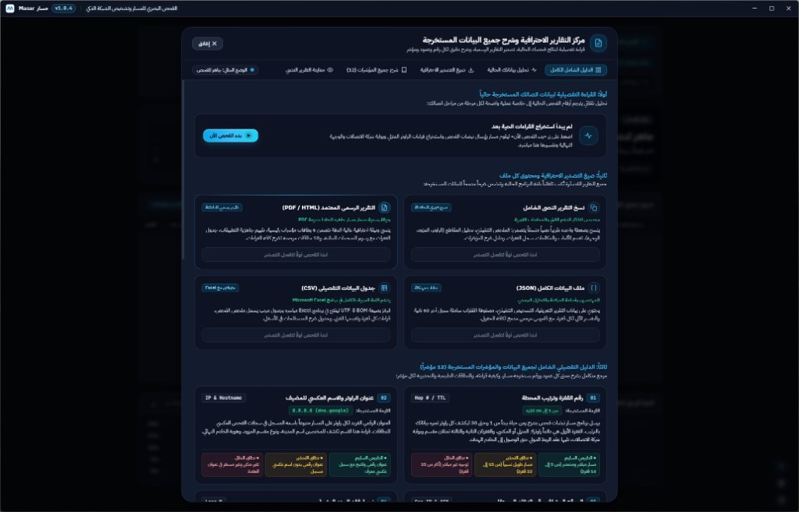

<div align="center">


# Masar · مسار

<p align="center">
  <strong>Native Windows Network Diagnostics, Hybrid L4 Visual MTR &amp; Speed Benchmark Suite</strong>
</p>
<p dir="rtl" align="center">
  <strong>أداة مكتبية احترافية لتشخيص الشبكة، وتتبع المسار البصري، وقياس السرعة بدقة لنظام ويندوز</strong>
</p>

[](https://github.com/mhmdrfx/masar/releases/latest)
[-0284c7?style=for-the-badge&logo=windows)](https://github.com/mhmdrfx/masar/releases/latest)
[](https://wails.io)
[](LICENSE)

<p align="center">
  <a href="https://github.com/mhmdrfx/masar/releases/latest">
    
  </a>
</p>

<h3>
  <a href="#-english-documentation">🇺🇸 English Documentation</a>
  &nbsp;&nbsp;|&nbsp;&nbsp;
  <a href="#-التوثيق-الكامل-باللغة-العربية">🇸🇦 التوثيق باللغة العربية</a>
</h3>

</div>

---

<a id="-english-documentation"></a>

# English Documentation

> Jump to section: [Overview](#-overview) · [Capabilities](#-key-capabilities) · [Screenshots](#-interface-preview) · [Installation](#-installation) · [Build from Source](#️-building-from-source) · [Architecture](#-project-architecture) · [Privacy & Signing](#-code-signing--privacy-policy) · [Switch to Arabic](#-التوثيق-الكامل-باللغة-العربية)

## 🌐 Overview

**Masar** is a lightweight, high-precision network diagnostics, route telemetry, and bandwidth benchmarking desktop application built natively for **Windows 10 / 11 (`x64`)**. Powered by a concurrent **Go** backend and a hardware-accelerated **Wails v2 / React** desktop interface, Masar unifies visual route tracing, encrypted DNS diagnostics, concurrent port & TLS auditing, and calibrated throughput testing in a single offline-capable workbench.

Whether you are isolating ISP peering congestion versus harmless intermediate hop rate-limiting, measuring real line capacity with Bufferbloat grading, verifying DNSSEC / DoH resolution, or exporting printable PDF diagnostics reports, Masar delivers clear, engineering-grade telemetry in real time.

---

## ✨ Key Capabilities

| Module | Engineering Highlights |
| :--- | :--- |
| **Hybrid Visual MTR (`ICMP / TCP / UDP`)** | Concurrent hop dispatcher (`TTL 1–30` at `1s` cadence) supporting **ICMPv4**, **TCP SYN**, and **UDP** probing, reporting per-hop `Loss%`, `Sent/Recv`, `Last`, `Avg`, `Best/Worst`, `Jitter`, `60s` sparklines, **ITU-T G.107 E-Model MOS** (`1.0–4.5`), silent-router rate-limit filtering, and an interactive **5-Minute Rolling Timeline Canvas** with route-shift markers. |
| **Calibrated Speedtest & Edge Matrix** | Races IPv4 and IPv6 POP candidates on startup (`speed.cloudflare.com`) to lock onto the lowest-RTT Anycast POP, supports **Multi** (`4–16` BDP-scaled HTTP/1.1 download and upload streams with bounded upload `SO_SNDBUF`) and **Single** (`1` stream) modes, measures pure **1-RTT `TCP SYN → SYN-ACK`** Idle/Loaded latency with **IQR outlier filtering** and a **20-Slice Trimmed Mean**, scores **Bufferbloat (`A+`–`F` + `p50/p95/p99`)**, and benchmarks 4 global Anycast edges (`1.1.1.1`, `8.8.8.8`, `9.9.9.9`, `208.67.222.222`). |
| **DNS Inspector (`DoH` & `DNSSEC`)** | Concurrent lookup for `A`, `AAAA`, `CNAME`, `MX`, `NS`, `TXT`, `SOA`, `CAA`, and Reverse `PTR` records via the **System Resolver**, custom UDP upstreams, or encrypted **DNS-over-HTTPS (RFC 8484)** with **DNSSEC (`AD` bit)** validation status and query latency per record. |
| **Concurrent Port Scanner & TLS Inspector** | 20-worker concurrent TCP handshake scanner with quick presets (`common`, `web`, `database`, `remote`) and custom ports/ranges (up to 128 ports per scan), paired with an **X.509 / TLS 1.3 Certificate & Handshake Inspector** showing negotiated protocol, cipher suite, chain trust, SANs, and expiry countdown. |
| **Diagnostic Report Studio & Exports** | Native save-dialog exports for **Printable HTML / PDF** (MTR route reports and Speedtest Bufferbloat reports), **CSV** (UTF-8 BOM, formula-injection sanitized), **JSON**, **Plain-Text**, and an interactive modal with a complete **12-Metric Threshold Dictionary**. |
| **Dual-Theme UI, Corner Dock & Offline Fonts** | Instant **English (`LTR`) / Arabic (`RTL`)** switching, **Carbon Slate Dark Mode** & **Soft Daylight Mode**, local bundled `@fontsource` fonts (`Inter`, `IBM Plex Sans Arabic`, `JetBrains Mono`) for crisp ClearType rendering without external requests, 60 FPS startup splash with optional harmonic chime, and a vertical bottom-right Corner Dock (**Zoom `80%–150%`**, **Language**, **Settings**). |

---

## 📸 Interface Preview

### 1. Visual MTR, Protocol Selector & 5-Minute Rolling Timeline
> Hybrid `ICMP / TCP / UDP` route diagnostics (`TTL 1–30`) featuring the 4-stage network path breakdown (`This Device → Local Gateway → ISP Backbone → Target`), Connection Health Score, export shortcuts, and the live **5-Minute Interactive Timeline**.

<p align="center">
  
</p>

### 2. DNS Record, DoH & Reverse PTR Inspector
> Concurrent querying of `A`, `AAAA`, `CNAME`, `MX`, `NS`, and `TXT / PTR / SOA` records with a selectable resolver (`System`, `1.1.1.1`, `8.8.8.8`, `9.9.9.9`, or custom IP) and encrypted **DoH** toggle.

<p align="center">
  
</p>

### 3. Concurrent TCP Port Scanner & TLS / SSL Certificate Inspector
> Multi-preset TCP port scanner (`common`, `web`, `database`, `remote`, or custom ranges) integrated alongside the **TLS / SSL (`X.509 / TLS 1.3`)** handshake and certificate validity inspector.

<p align="center">
  
</p>

### 4. Speedtest • Bandwidth & Anycast Edge Latency
> Dedicated Speedtest workbench displaying Download, Upload, and Idle Ping telemetry cards, `Multi / Single` TCP mode selector, auto-detected ISP & Anycast POP card, and the 4-provider Global Edge Latency Matrix.

<p align="center">
  
</p>

### 5. Diagnostic Report Studio & 12-Metric Data Guide
> Interactive Report Studio modal offering one-click `PDF / HTML`, `JSON`, `CSV`, and text exports alongside a structured **12-Metric Dictionary** detailing Healthy, Warning, and Critical thresholds for every extracted indicator.

<p align="center">
  
</p>

---

## 🚀 Installation

### Standard Installer (Recommended)

1. Download [**`Masar-Setup.exe`**](https://github.com/mhmdrfx/masar/releases/latest) from the [GitHub Releases](https://github.com/mhmdrfx/masar/releases/latest) page (and optionally verify it against `Masar-Setup.exe.sha256`).
2. Run **`Masar-Setup.exe`** and follow the setup wizard (configures Desktop & Start Menu shortcuts, `AppUserModelID`, and checks Microsoft Edge WebView2 runtime).
3. Launch **Masar** from your Desktop or Start Menu (`Run as Administrator` is optional and improves raw socket capture coverage where needed).

### Windows Package Manager (`winget`)

> **Status note:** The initial package submission for `mhmdrfx.Masar` is currently awaiting moderator approval in `microsoft/winget-pkgs` ([PR #476844](https://github.com/microsoft/winget-pkgs/pull/476844)). Once merged, you can install or upgrade directly from PowerShell or Windows Terminal:

```powershell
# Install Masar
winget install mhmdrfx.Masar

# Upgrade to latest release
winget upgrade mhmdrfx.Masar
```

---

## 🛠️ Building from Source

### Prerequisites
- **Go** `1.26+`
- **Node.js** `22+` & `npm`
- **Wails CLI** `v2` (`go install github.com/wailsapp/wails/v2/cmd/wails@latest`)
- **NSIS** `3.x` (required only when building `Masar-Setup.exe`)

### Build Commands

```powershell
# 1. Clone the repository
git clone https://github.com/mhmdrfx/masar.git
cd masar

# 2. Install frontend dependencies & bundle production assets
npm --prefix frontend ci
npm --prefix frontend run build

# 3. Run unit tests across all Go packages
go test -v ./...

# 4. Build standalone executable & NSIS Windows Installer
wails build -nsis -s
```

The compiled executable (`masar.exe`) and setup wizard (`Masar-Setup.exe`) will be placed in `build/bin/`.

---

## 📂 Project Architecture

```text
masar/
├── app.go                                   # Wails application lifecycle, IPC bindings & updater hooks
├── app_windows.go / app_other.go            # Windows AppUserModelID (mhmdrfx.Masar) & platform hooks
├── main.go                                  # Native window configuration & asset embedding
├── report_export.go                         # Native save-dialog & HTML/CSV/TXT Visual MTR report engine
├── report_speed.go                          # Speed Benchmark HTML/PDF report generator with Bufferbloat tables
├── updater.go / updater_windows.go          # In-app GitHub release checker & SHA-256 verified updater
├── internal/
│   ├── mtr/
│   │   ├── mtr.go / probe_windows.go        # Concurrent ICMPv4 tracer, E-Model MOS, silent-router & Geo/ASN cache
│   │   └── probe_l4.go / probe_l4_windows.go# Layer-4 TCP & UDP hop probes
│   └── nettools/
│       ├── nettools.go                      # IPv4/IPv6 POP race, BDP-scaled speedtest, 1-RTT ping & port scan
│       └── advanced_tools.go                # DoH/DNSSEC resolver, custom port specs, Bufferbloat & TLS inspector
├── frontend/
│   └── src/
│       ├── App.jsx                          # Bilingual workbench UI (MTR, DNS, Ports, Speedtest & Corner Dock)
│       ├── main.jsx & style.css             # Bundled @fontsource fonts & Carbon Dark / Soft Daylight themes
│       ├── ReportStudio.jsx                 # Report format builders & 12-metric dictionary definitions
│       ├── ReportStudioModal.jsx            # Lazy-loaded Report Studio preview & export modal
│       ├── UpdateManager.jsx                # In-app GitHub release checker & SHA-256 installer
│       ├── components/
│       │   ├── MtrTimelineCanvas.jsx        # Interactive 5-minute rolling MTR timeline Canvas
│       │   └── TlsInspectorCard.jsx         # X.509 / TLS 1.3 handshake & certificate expiry card
│       └── motion/                          # 60 FPS GPU motion choreography, Lottie & CSS tokens
├── docs/screenshots/                        # High-resolution English & Arabic UI screenshots
└── build/windows/installer/project.nsi      # Custom NSIS installer script (Masar-Setup.exe)
```

---

## 🔏 Code Signing & Privacy Policy

### Code Signing Policy
Free code signing provided by [SignPath.io](https://about.signpath.io), certificate by [SignPath Foundation](https://signpath.org).

- **Committers and reviewers:** [@mhmdrfx](https://github.com/mhmdrfx)
- **Approvers:** [@mhmdrfx](https://github.com/mhmdrfx)

Every official release binary (`Masar-Setup.exe`) is built exclusively from this public repository by the automated GitHub Actions workflow [`release.yml`](.github/workflows/release.yml).

### Privacy Policy
Masar will **not** transfer any information to networked systems unless explicitly initiated by the user:
- **Route Tracing (MTR):** Sends ICMPv4, TCP, or UDP probes solely to the user-entered host and resolves public hop Geo-IP/ASN metadata via `ip-api.com`.
- **Speed Benchmark:** Measures throughput against `speed.cloudflare.com` (selecting the lowest-RTT IPv4/IPv6 POP) and latency against public edge endpoints (`1.1.1.1:443`, `8.8.8.8:443`, `9.9.9.9:443`, `208.67.222.222:443`).
- **DNS, Port & TLS Inspector:** Queries only the chosen upstream (`System Resolver`, custom UDP server, or user-enabled DoH provider) and connects solely to the target host and ports entered by the user.
- **Updates:** Checks GitHub Releases on user request and verifies downloads with SHA-256 checksums.

Masar contains **zero** third-party telemetry, tracking, analytics, or advertising. Diagnostic reports are saved locally only.

---

## 📄 License

Distributed under the **MIT License**. See [`LICENSE`](LICENSE) for full details.

<br />

---

<a id="-التوثيق-الكامل-باللغة-العربية"></a>

<div dir="rtl" align="right">

# التوثيق الكامل باللغة العربية

> الانتقال السريع: [نظرة عامة](#-نظرة-عامة) · [المميزات وآلية العمل](#-المميزات-الهندسية-وآلية-العمل) · [معاينة الواجهة](#-معاينة-واجهة-البرنامج) · [طريقة التثبيت](#-طريقة-التثبيت-والتحديث) · [البناء من المصدر](#️-البناء-من-المصدر-للمطورين) · [هيكل المشروع](#-هيكل-المشروع-البرمجي) · [الخصوصية والتوقيع](#-سياسة-التوقيع-الرقمي-والخصوصية) · [English Docs](#-english-documentation)

## 🧭 نظرة عامة

**مسار (<bdi>Masar</bdi>)** هو تطبيق مكتبي احترافي خفيف وعالي الدقة لتشخيص الشبكات، وتتبع المسار البصري، وفحص السجلات والمنافذ والشهادات، وقياس سرعة الإنترنت، طُوّر أصلياً لنظام **<bdi>Windows 10 / 11 (x64)</bdi>** بلغة **<bdi>Go</bdi>** وإطار **<bdi>Wails v2 / React</bdi>**. يجمع التطبيق بين الأداء المباشر على مستوى النظام وواجهة حديثة ثنائية اللغة تعمل محلياً وتغنيك عن تشتت أدوات سطر الأوامر التقليدية (`ping`، `tracert`، `nslookup`، `netstat`).

سواء كنت تبحث عن سبب تذبذب البينغ في الألعاب، أو تمييز الفقدان الحقيقي للحزم عن تجاهل الراوترات الوسيطة، أو قياس السرعة والـ <bdi>Bufferbloat</bdi> بدقة واستخراج تقارير <bdi>PDF / HTML</bdi> احترافية لمزود الخدمة، يمنحك **مسار** تشخيصاً فورياً وموثوقاً.

---

## ✨ المميزات الهندسية وآلية العمل

| الوحدة | التفاصيل التقنية وآلية الفحص |
| :--- | :--- |
| **تتبع المسار البصري الهجين (<bdi>ICMP / TCP / UDP</bdi>)** | إرسال نبضات فحص كل ثانية عبر القفزات (`TTL 1–30`) باختيار بروتوكول **`ICMP`** أو **`TCP`** أو **`UDP`**، مع عرض نسبة الفقد، والمُرسل/المستلم، وأفضل/متوسط/أسوأ/آخر استجابة، والتذبذب (`Jitter`)، ومنحنى آخر 60 ثانية، ومقياس جودة المكالمات **`MOS` (`1.0–4.5`)**، وتصفية تجاهل الراوترات الصامتة، و**الخط الزمني التفاعلي طويل المدى (5 دقائق)** مع مؤشرات تغيّر المسار. |
| **قياس السرعة المعاير وحواف <bdi>Anycast</bdi>** | سباق فوري بين **`IPv4` و`IPv6`** لتثبيت أقرب خادم `Cloudflare Anycast CDN` بأقل زمن استجابة، ودعم **متعدد القنوات** (`4–16` قناة `TCP HTTP/1.1` مكيّفة حسب الـ BDP للتحميل والرفع مع ضبط `SO_SNDBUF`) أو **قناة واحدة**، وقياس نقي لزمن الاستجابة عبر مصافحة **`1-RTT TCP SYN → SYN-ACK`** وتصفية **`IQR`**، و**متوسط 20 شريحة مشذّب**، مع تقييم **`Bufferbloat` (`A+` إلى `F` والنسب المئوية `p50/p95/p99`)** ومقارنة 4 خوادم سحابية عالمية. |
| **فاحص سجلات النطاقات (<bdi>DNS / DoH / DNSSEC</bdi>)** | استعلام متوازٍ لسجلات **`A` و`AAAA` و`CNAME` و`MX` و`NS` و`TXT` و`SOA` و`CAA`** والفحص العكسي **`PTR`** عبر **خادم النظام** أو خوادم `UDP` مخصصة أو **DNS-over-HTTPS (`DoH`)** المشفر مع التحقق من توقيع **`DNSSEC` (`AD bit`)**. |
| **فاحص المنافذ المتوازي وفاحص شهادات <bdi>TLS / SSL</bdi>** | فاحص منافذ `TCP` متزامن (`20` اتصالاً متوازياً) مع قوالب جاهزة (`common`، `web`، `database`، `remote`) وإمكانية إدخال منافذ أو نطاقات مخصصة، مدمج مع بطاقة **فاحص شهادات `TLS 1.3 / X.509`** لعرض بروتوكول التفاوض، وخوارزمية التشفير، وسلسلة الثقة، والأسماء المشمولة (`SANs`)، والأيام المتبقية لانتهاء الشهادة. |
| **مركز التقارير الاحترافية والتصدير** | نافذة حفظ أصلية في ويندوز لتصدير تقارير **<bdi>HTML / PDF</bdi>** رسمية (لتتبع المسار ولقياس السرعة مع جداول `Bufferbloat`)، وملفات **<bdi>CSV</bdi>** متوافقة مع Excel (`UTF-8 BOM`) ومحصّنة، وملفات **<bdi>JSON</bdi>** والنص الشامل، مع **دليل تفصيلي تفاعلي لـ 12 مؤشراً**. |
| **الثيمات ووضوح الخطوط وشريط الزاوية** | تبديل فوري بين العربية (`RTL`) والإنجليزية (`LTR`)، والوضع الداكن (**`Carbon Slate`**) والوضع النهاري المريح (**`Soft Daylight`**)، مع تضمين خطوط `@fontsource` محلياً (`Inter` و`IBM Plex Sans Arabic` و`JetBrains Mono`) لوضوح مثالي دون اعتماد على الإنترنت، وشاشة إقلاع انسيابية، وشريط تحكم عمودي في الزاوية السفلية اليمنى (**التكبير `80%–150%`**، **اللغة**، **الإعدادات**). |

---

## 📸 معاينة واجهة البرنامج

### 1. تتبع المسار البصري والخط الزمني التفاعلي (5 دقائق)
> واجهة الفحص البصري مع أزرار اختيار البروتوكول (**`ICMP` / `TCP` / `UDP`**)، وخريطة المراحل الأربع (`جهازك ← الراوتر المحلي ← بوابة المزود ← الوجهة النهائية`)، ومؤشر جودة الاتصال، وأزرار التصدير الفورية، والخط الزمني التفاعلي طويل المدى.

<p align="center">
  
</p>

### 2. فاحص سجلات النطاقات (`DNS / DoH`) والفحص العكسي
> استعلام متزامن لسجلات `A` و`AAAA` و`CNAME` و`MX` و`NS` و`TXT / PTR / SOA` مع اختيار المحلل (`System` أو `1.1.1.1` أو `8.8.8.8` أو `9.9.9.9` أو عنوان مخصص) وزر تفعيل الاستعلام المشفر **`DoH`**.

<p align="center">
  
</p>

### 3. فاحص المنافذ المتوازي وفاحص شهادات `TLS / SSL`
> فحص سريع لقوالب المنافذ القياسية (`common`، `web`، `database`، `remote`) أو نطاقات مخصصة، وبأسفله مباشرة وحدة فحص تفاوض التشفير وشهادات **`X.509 / TLS 1.3`**.

<p align="center">
  
</p>

### 4. واجهة قياس السرعة الاحترافي ومصفوفة الحواف العالمية
> واجهة اختبار السرعة الدائرية مع بطاقات التحميل والرفع واستجابة الخمول والتذبذب، واختيار نمط الاتصال (`متعدد القنوات` / `قناة واحدة`)، وكشف مزود الخدمة والخادم المستضاف تلقائياً مع مصفوفة استجابة الحواف العالمية (`Cloudflare` و`Google` و`Quad9` و`OpenDNS`).

<p align="center">
  
</p>

### 5. مركز التقارير الاحترافية والدليل الشامل للمؤشرات
> مركز متكامل يعرض ملخص الفحص الحي، وخيارات التصدير الرسمية (`نسخ النص`، `PDF / HTML`، `JSON`، `CSV`)، وشرحاً تفصيلياً لكل مؤشر من المؤشرات الـ 12 مع النطاق السليم ونطاق التحذير والنطاق الحرج.

<p align="center">
  
</p>

---

## 🚀 طريقة التثبيت والتحديث

### الطريقة الأولى: المثبت الرسمي (موصى بها)
1. قم بتحميل المثبت الرسمي [**<bdi>Masar-Setup.exe</bdi>**](https://github.com/mhmdrfx/masar/releases/latest) من صفحة [الإصدارات](https://github.com/mhmdrfx/masar/releases/latest) (مع توفر ملف التحقق `Masar-Setup.exe.sha256`).
2. شغّل ملف **<bdi>Masar-Setup.exe</bdi>** واتبع خطوات معالج التثبيت؛ حيث ينشئ اختصارات سطح المكتب وقائمة ابدأ ويسجّل هوية التطبيق في شريط المهام ويتحقق من وجود بيئة <bdi>WebView2</bdi>.
3. افتح برنامج **مسار** مباشرة وابدأ الفحص فوراً (يدعم التشغيل كمسؤول لتوسيع تغطية فحص حزم الشبكة المباشرة عند الحاجة).

### الطريقة الثانية: عبر مدير حزم ويندوز (<bdi>winget</bdi>)

> **ملاحظة:** طلب إدراج الحزمة `mhmdrfx.Masar` قيد المراجعة النهائية حالياً في مستودع `microsoft/winget-pkgs` ([PR #476844](https://github.com/microsoft/winget-pkgs/pull/476844)). فور اعتماده ودمجه ستتمكن من التثبيت والتحديث مباشرة عبر <bdi>PowerShell</bdi>:

```powershell
# لتثبيت مسار
winget install mhmdrfx.Masar

# للتحديث إلى أحدث إصدار
winget upgrade mhmdrfx.Masar
```

---

## 🛠️ البناء من المصدر (للمطورين)

### المتطلبات الأساسية
- **<bdi>Go</bdi>** إصدار `1.26+`
- **<bdi>Node.js</bdi>** إصدار `22+` مع `<bdi>npm</bdi>`
- **<bdi>Wails CLI</bdi>** إصدار `v2` عبر الأمر: `<bdi>go install github.com/wailsapp/wails/v2/cmd/wails@latest</bdi>`
- **<bdi>NSIS</bdi>** إصدار `3.x` (مطلوب فقط عند بناء ملف التثبيت `<bdi>Masar-Setup.exe</bdi>`)

### أوامر البناء والتشغيل

```powershell
# 1. استنساخ المستودع
git clone https://github.com/mhmdrfx/masar.git
cd masar

# 2. تثبيت حزم الواجهة وبناء الملفات الثابتة
npm --prefix frontend ci
npm --prefix frontend run build

# 3. تشغيل الاختبارات البرمجية للتحقق من سلامة الحزم
go test -v ./...

# 4. بناء البرنامج التنفيذي وملف التثبيت الرسمي لنظام ويندوز
wails build -nsis -s
```

ستجد الملف التنفيذي (`masar.exe`) وملف المثبت (`Masar-Setup.exe`) داخل المجلد `build/bin/`.

---

## 📂 هيكل المشروع البرمجي

```text
masar/
├── app.go                                   # إدارة دورة حياة التطبيق والربط البرمجي (Wails IPC)
├── app_windows.go / app_other.go            # تعريف هوية التطبيق في شريط مهام ويندوز (AppUserModelID)
├── main.go                                  # إعدادات النافذة الرئيسية وتضمين الموارد
├── report_export.go                         # محرك حفظ وتصدير تقارير تتبع المسار (HTML / CSV / TXT)
├── report_speed.go                          # محرك تقارير فحص السرعة الرسمية (PDF / HTML) وجداول Bufferbloat
├── updater.go / updater_windows.go          # نظام التحديث الآمن والتحقق ببصمة SHA-256
├── internal/
│   ├── mtr/
│   │   ├── mtr.go / probe_windows.go        # محرك ICMPv4، وحساب MOS، وتصفية القفزات الصامتة، وذاكرة Geo/ASN
│   │   └── probe_l4.go / probe_l4_windows.go# وحدة فحص مسار TCP و UDP على الطبقة الرابعة
│   └── nettools/
│       ├── nettools.go                      # سباق IPv4/IPv6 POP، فحص السرعة بـ BDP، بينغ 1-RTT، وفاحص المنافذ
│       └── advanced_tools.go                # محلل DoH/DNSSEC، قوالب المنافذ المخصصة، Bufferbloat وفاحص TLS
├── frontend/
│   └── src/
│       ├── App.jsx                          # الواجهة الرئيسية ثنائية اللغة وشريط الزاوية السفلي
│       ├── main.jsx & style.css             # خطوط @fontsource المدمجة وثيمي Carbon Slate و Soft Daylight
│       ├── ReportStudio.jsx                 # بناء صيغ التقارير وتعريفات قاموس الـ 12 مؤشراً
│       ├── ReportStudioModal.jsx            # نافذة مركز التقارير الاحترافية بالتحميل الكسول (Lazy Modal)
│       ├── UpdateManager.jsx                # واجهة التحقق من التحديثات والتثبيت الآمن
│       ├── components/
│       │   ├── MtrTimelineCanvas.jsx        # لوحة الخط الزمني التفاعلي طويل المدى (5 دقائق)
│       │   └── TlsInspectorCard.jsx         # بطاقة فحص شهادات TLS 1.3 / X.509
│       └── motion/                          # محرك الانميشن السلس 60 FPS وأصول Lottie
├── docs/screenshots/                        # لقطات شاشة حديثة عالية الدقة للواجهتين العربية والإنجليزية
└── build/windows/installer/project.nsi      # سكربت بناء المثبت الرسمي (Masar-Setup.exe)
```

---

## 🔏 سياسة التوقيع الرقمي والخصوصية

### سياسة التوقيع الرقمي (<bdi>Code Signing</bdi>)
توقيع الكود المجاني مقدم من [<bdi>SignPath.io</bdi>](https://about.signpath.io) والشهادة من [<bdi>SignPath Foundation</bdi>](https://signpath.org).
* **المساهمون والمراجعون والمعتمدون:** [<bdi>@mhmdrfx</bdi>](https://github.com/mhmdrfx)
* تُبنى جميع ملفات الإصدار الرسمية (<bdi>Masar-Setup.exe</bdi>) حصرياً عبر مسار النشر المؤتمت على GitHub Actions ([`<bdi>release.yml</bdi>`](.github/workflows/release.yml)) من هذا المستودع العام.

### سياسة الخصوصية (<bdi>Privacy Policy</bdi>)
برنامج **مسار** لا يرسل أو ينقل أي بيانات من جهازك إلى أي خادم خارجي إلا عند طلبك المباشر لبدء الفحص:
* **تتبع المسار (<bdi>Visual MTR</bdi>):** يرسل حزم `ICMPv4` أو `TCP` أو `UDP` للوجهة التي تحددها فقط، ويستعلم عن الموقع الجغرافي لعناوين الشبكة العامة عبر `<bdi>ip-api.com</bdi>`.
* **فحص السرعة (<bdi>Speed Benchmark</bdi>):** يقيس السرعة عبر `<bdi>speed.cloudflare.com</bdi>` (مع اختيار أقرب POP عبر IPv4/IPv6)، ويقيس زمن الاستجابة لحواف DNS العالمية (`1.1.1.1:443`، `8.8.8.8:443`، `9.9.9.9:443`، `208.67.222.222:443`).
* **فاحص <bdi>DNS</bdi> والمنافذ وشهادات <bdi>TLS</bdi>:** يتصل فقط بالمحلل الذي تختاره (خادم النظام أو UDP أو DoH) وبالأهداف والمنافذ التي تُدخلها يدوياً.
* **التحديثات:** تتحقق من وجود إصدارات جديدة عبر GitHub بموافقتك الكاملة ومع التحقق من بصمة الملف (`SHA-256`).

لا يحتوي التطبيق على أي أكواد تتبع، أو إعلانات، أو جمع بيانات مخفي؛ وتُحفظ كافة التقارير محلياً على جهازك فقط.

---

## 📄 الرخصة

مرخّص بموجب **رخصة <bdi>MIT</bdi>** مفتوحة المصدر. راجع ملف [`LICENSE`](LICENSE) للتفاصيل الكاملة.

</div>

<div align="center">
  <br />
  <sub>Engineered &amp; Maintained by <a href="https://github.com/mhmdrfx"><strong>@mhmdrfx</strong></a> · طُوّر بعناية لخدمة مجتمع الشبكات</sub>
</div>
